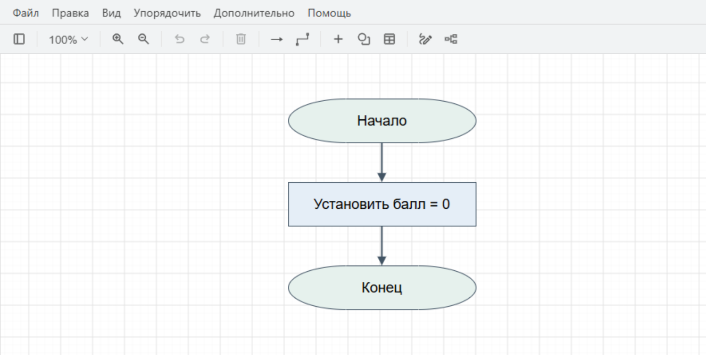
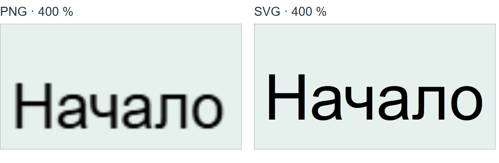
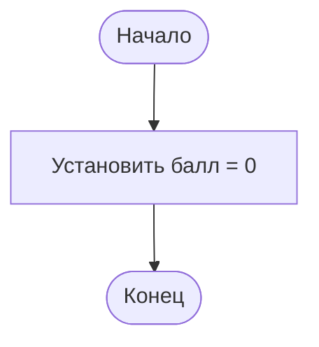
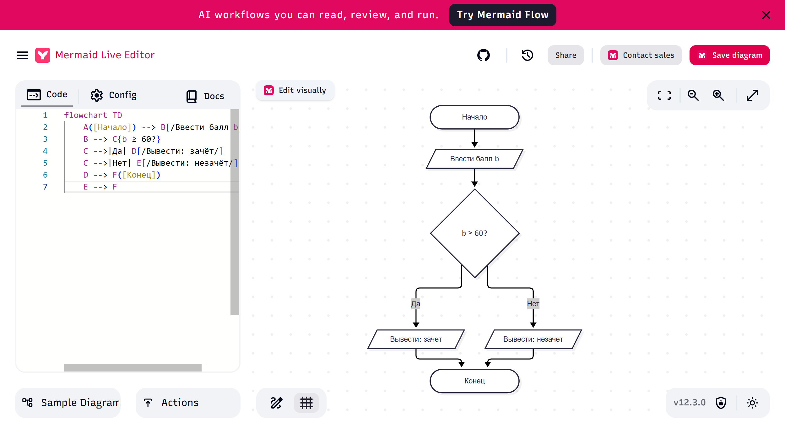
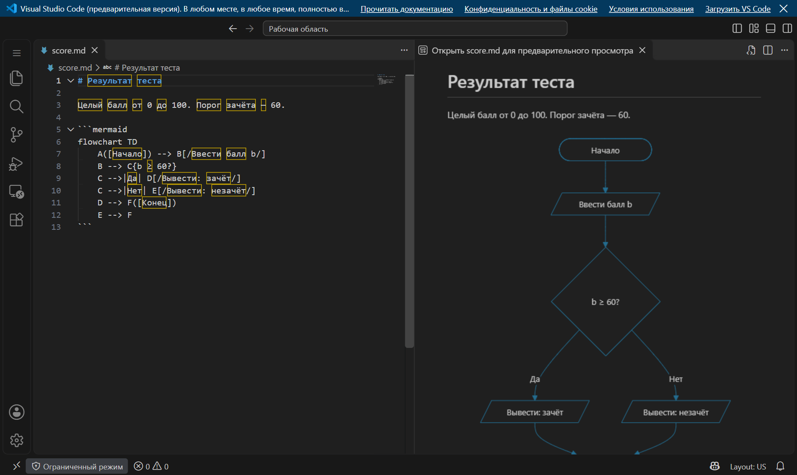
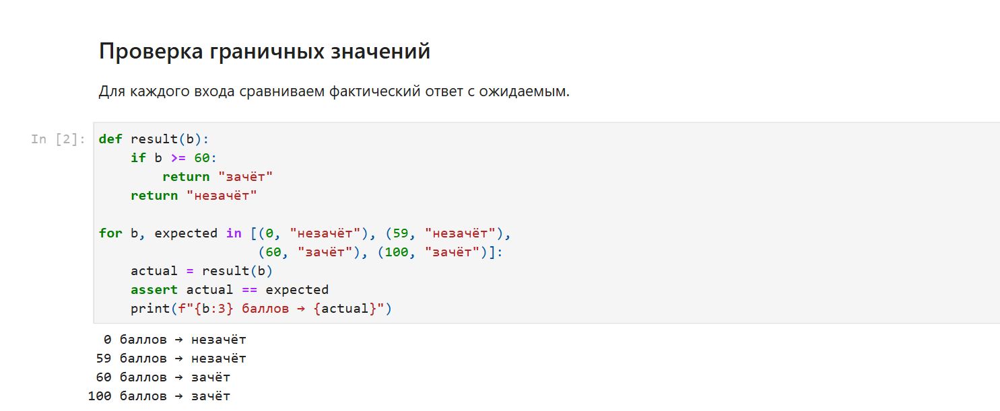
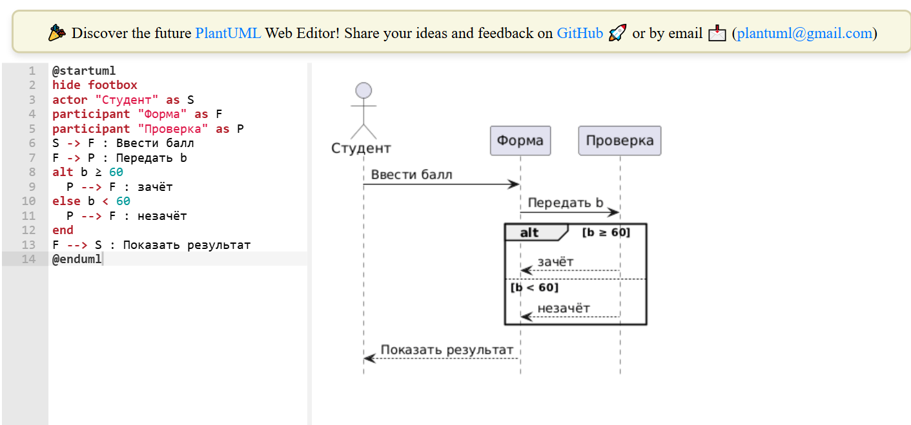
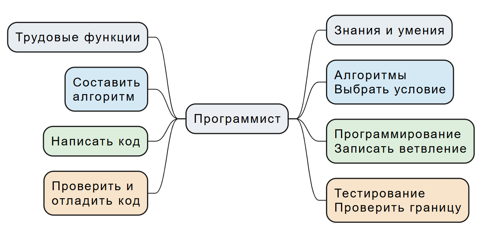

ФГБОУ ВО  
Уфимский университет науки и технологий  
Кафедра технической кибернетики

# Отчёт по лабораторной работе № 3

по дисциплине «Цифровые технологии и искусственный интеллект»

Выполнил:  
ст. гр. ИВТ-ИСУ-104Б  
Асфандияров В.Н.

Проверил:  
Преподаватель кафедры АСУ  
Зиязетдинов Д.С.

Уфа 2026

## Цель работы

Построить схему алгоритма в Draw.io и Mermaid, описать взаимодействие участников с помощью UML и составить интеллект-карту профессии программиста в PlantUML.

## Ход работы

Алгоритм задаёт порядок действий, по которому из входных данных получают результат. Название восходит к имени математика аль-Хорезми. На схеме порядок задают стрелки. Формы блоков позволяют отличить действие от проверки условия. Условные обозначения описаны в ГОСТ 19.701–90.

Для первой схемы выбран один шаг — присвоить переменной начальное значение. В Draw.io между двумя терминаторами «Начало» и «Конец» расположен прямоугольный блок присваивания. Обе стрелки направлены вниз.

*Рисунок 1 – Линейный алгоритм в редакторе Draw.io*

### Сохранение схемы и сравнение форматов

Схема сохранена в XML, PNG, SVG и HTML. XML хранит блоки и их связи для редактирования. PNG удобно вставлять в Word. SVG сохраняет чёткие контуры при увеличении. HTML содержит модель схемы и подключает средство просмотра.

*Рисунок 2 – Один фрагмент экспорта Draw.io при увеличении в четыре раза*

Для сравнения оба файла открыты в браузере с одинаковой шириной изображения. На буквах надписи «Начало» виден результат: у PNG на границе штрихов появился размытый край, а у SVG граница осталась резкой.

Ту же линейную схему можно задать тремя строками Mermaid. Узлы A и C имеют форму терминатора, B обозначает действие. Узел B встречается в двух строках и соединяет начало с концом.

Для вставки в Word подходит готовое изображение. В Markdown для файла SVG используется запись ``. Если вставить сам код в блок mermaid, правка текста изменит схему при следующем просмотре.

### Проверка результата теста в Mermaid

Усложним задачу. На вход поступает целый балл b от 0 до 100. При 60 баллах и выше нужно вывести «зачёт», при меньшем значении — «незачёт». Вход уже проверен на допустимость. Поэтому схема содержит одно условие.

*Рисунок 3 – Код Mermaid и обе ветви алгоритма*

Запись flowchart TD задаёт направление сверху вниз. В ромбе C проверяется условие b ≥ 60. Переход с подписью «Да» ведёт к выводу зачёта, переход «Нет» — к выводу незачёта. После вывода обе ветви сходятся в одном блоке «Конец».

При b = 60 выполняется ветвь «Да». Если заменить знак ≥ на >, изменится ответ именно для 60 баллов. Этот случай включён в проверку вместе с ближайшим меньшим значением.

### Диаграмма в Markdown и VS Code

В файле score.md описание алгоритма помещено между строками из трёх обратных кавычек. После открывающих кавычек указано mermaid. Такой блок поддерживается в Markdown на GitHub. Для проверки файл открыт в VS Code и рядом включён предпросмотр.

*Рисунок 4 – Исходный Markdown и его предпросмотр в VS Code*

Слева видны текст и метки переходов. Справа VS Code построил ромб с тем же условием и две стрелки с подписями. И заголовок страницы, и диаграмма получены из одного файла.

В комплекте с отчётом сохранён README.md. Mermaid-схемы включены в него как код, а карта и UML-диаграмма — как изображения с относительными путями. Файлы PlantUML приложены рядом для редактирования.

### Блокнот для Google Colab и проверка алгоритма

В блокноте 06-score.ipynb исходный текст Mermaid хранится в многострочной строке Python. Текст кодируется в UTF-8, сжимается и переводится в URL-безопасный Base64. Из результата формируются две ссылки — на редактор Mermaid Live и на SVG через Mermaid Ink. Копия схемы встроена и в текстовую ячейку.

Блокнот выполнен локально в ядре Python 3. Функция result повторяет условие из ромба. Оператор assert для каждого входа сравнивает вычисленную строку с ожидаемой. Результат выводится после успешной проверки.

*Рисунок 5 – Выполненная ячейка блокнота с четырьмя проверками*

Нижняя и верхняя границы диапазона дали ожидаемые ответы. На соседних значениях 59 и 60 результат изменился с «незачёт» на «зачёт». Все четыре сравнения выполнены успешно.

### Диаграмма последовательности в PlantUML

Ту же задачу можно рассмотреть со стороны участников. Студент вводит балл в форму, форма передаёт его на проверку и показывает полученный ответ. Для такого описания построена UML-диаграмма последовательности.

*Рисунок 6 – Сообщения и условный фрагмент в редакторе PlantUML*

Вертикальные линии соответствуют участникам, ход времени направлен вниз. Сплошные стрелки показывают ввод и передачу балла. Пунктирные стрелки показывают возврат ответа. Фрагмент alt разделён на две области по условию b ≥ 60.

Для b = 59 проверка возвращает форме «незачёт». Для b = 60 она возвращает «зачёт». Сообщение «Показать результат» вынесено за границы alt, поскольку форма показывает ответ при любом исходе.

### Интеллект-карта профессии программиста

За основу взят профстандарт «Программист» (06.001). Для карты отобраны три действия, которые встречаются в этой работе. Каждому поставлено в соответствие конкретное умение. Например, при отладке проверки балла требуется подобрать значения непосредственно по обе стороны порога.

*Рисунок 7 – Трудовые функции слева и знания и умения справа*

Голубая пара связывает составление алгоритма с выбором условия. Зелёная — написание кода с записью ветвления. Оранжевая — проверку и отладку с тестированием границы. Цвет дублирует порядок ветвей, поэтому соответствия можно прочитать и сверху вниз.

Сохранены четыре версии карты. В первой есть только корень, во второй добавлены действия, в третьей отдельно собраны знания и умения. В четвёртой версии обе части объединены. Команда left side переносит ветви функций влево, а переносы строк делают подписи компактнее.

## Вывод

Одна задача представлена с двух сторон. Блок-схема показывает, почему 60 баллов дают зачёт, а диаграмма последовательности — как ответ проверки доходит до студента. Четыре теста подтвердили обе ветви и переход через порог. Карта профессии связывает каждый этап работы с умением, которое для него понадобилось.

## Источники и материалы

Арьков В. Ю. Цифровые технологии и искусственный интеллект. Учебное пособие. 2024. Глава 3 «Диаграмма как код», с. 74–137.

- [Росстандарт. ГОСТ 19.701–90. Схемы алгоритмов, программ, данных и систем](https://protect.gost.ru/gost/details/0c85e066-f89e-433d-a6d3-b7f746bd0c7c)
- [Минтруд России. Приказ от 20.07.2022 № 424н. Профессиональный стандарт «Программист»](https://mintrud.gov.ru/docs/mintrud/orders/2403)
- [Draw.io. Форматы экспорта диаграмм](https://www.drawio.com/doc/faq/export-diagram)
- [Mermaid. Обозначения для блок-схем](https://mermaid.js.org/syntax/flowchart.html)
- [GitHub Docs. Диаграммы внутри Markdown](https://docs.github.com/en/get-started/writing-on-github/working-with-advanced-formatting/creating-diagrams)
- [Visual Studio Code. Предварительный просмотр Markdown](https://code.visualstudio.com/docs/languages/markdown)
- [Mermaid Ink. Получение диаграммы по URL](https://mermaid.ink/)
- [PlantUML. Диаграммы последовательности](https://plantuml.com/sequence-diagram)
- [PlantUML. Интеллект-карты](https://plantuml.com/mindmap-diagram)
